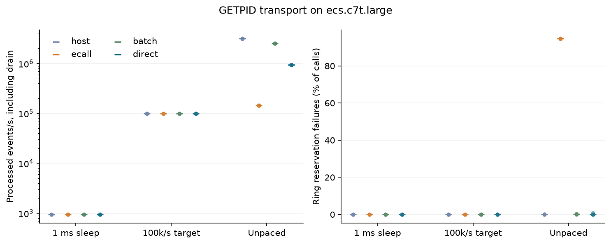
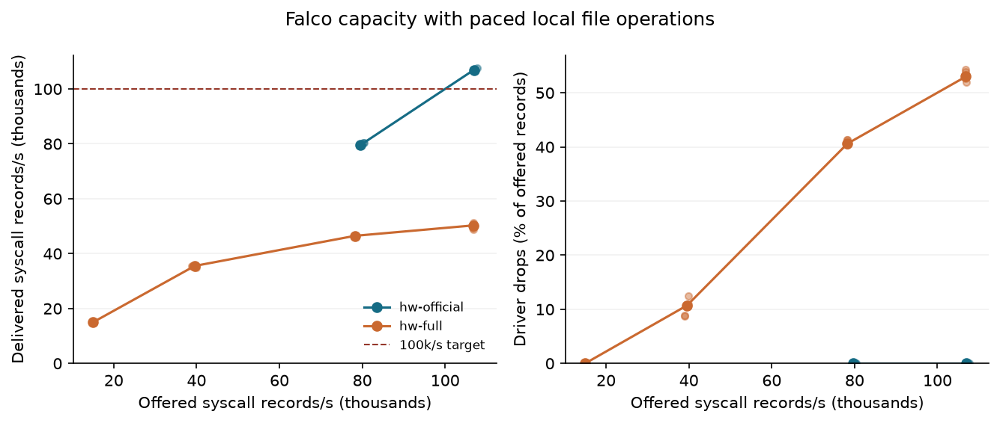
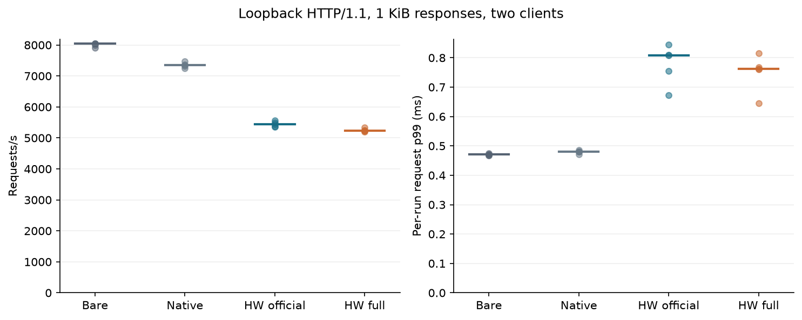
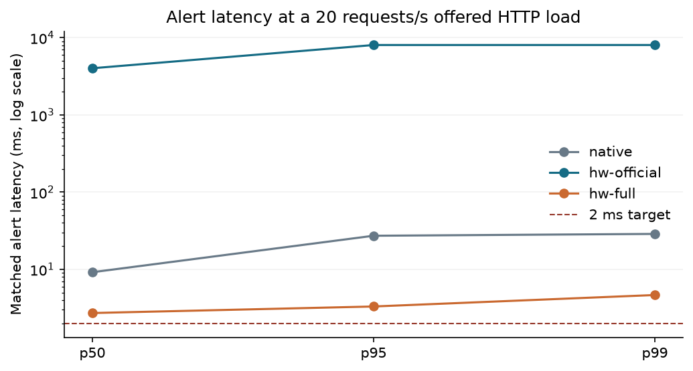
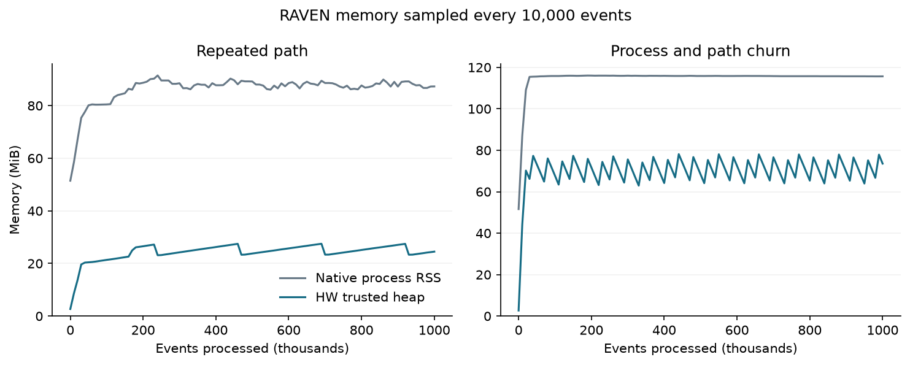

# 阿里云 ecs.c7t.large 硬件 SGX 非调试性能实测（已过时）

> **已过时。** 本报告的 Falco 性能数据已被 [ecs.c7t.xlarge 复测报告](../../../aliyun-c7t-xlarge/runs/20261125T130226Z-13d592774b63/REPORT.md)取代。本批运行的 `31ff860` 与当前源码在线程结构、事件订阅和告警刷新上都不同。GETPID 结果仍以本批为准，告警一致性对照只作历史参考。

批次 `20261123T073338Z-31ff86016fe5`。上海地域、Ubuntu 22.04.5、内核 `5.15.0-198-generic`、Xeon Platinum 8369B。实例向客体提供同一物理核的 2 个线程，Linux 可见内存为 1,756,258,304 字节，驱动识别 1,984 MiB EPC。[环境输出](raw/host-preflight-r01/stdout.txt)

GETPID 和 Falco 的运行中 REPORT 均为 **DEBUG=0**。两份报告的 MRENCLAVE、MRSIGNER 均与各自签名镜像匹配，SGX 驱动初始化成功。Falco 离线和实时使用同一签名镜像。客体暴露 PCID 和 INVPCID，CPUID 的 PKS 位为 0，MOAT 硬件对照缺少运行条件。[身份记录](record.md) · [Falco 签名核验](raw/falco-offline-r02/identity.json) · [CPUID](evidence/cpuid.txt)

## 两项性能目标

| 测试对象 | 判据 | 观测结果 |
| --- | --- | --- |
| SGX 官方规则 现场吞吐 | 60 秒窗口交付 ≥100,000 条系统调用记录/秒且零丢失 | 5/5 轮达标，实收 106,929（106,900–107,748） 条/秒 |
| SGX 官方规则 + RAVEN/Zeek 现场吞吐 | 60 秒窗口交付 ≥100,000 条系统调用记录/秒且零丢失 | 0/5 轮达标，实收 50,284（48,848–51,321） 条/秒 |
| 普通 Falco 低负载告警 | p99 < 2 ms | p99 28.805 ms，成功配对 595/595。未达标 |
| SGX 官方规则 低负载告警 | p99 < 2 ms | p99 8,047.168 ms，成功配对 595/595。未达标 |
| SGX 官方规则 + RAVEN/Zeek 低负载告警 | p99 < 2 ms | p99 4.659 ms，成功配对 595/595。未达标 |

吞吐采用驱动采集起止之间的系统调用实收条数。告警延迟采用同一主机的 CLOCK_MONOTONIC，从测试子进程即将执行标记命令，到宿主读到对应官方告警。低负载使用两条本机 HTTP 持久连接，每条目标 10 请求/秒。表中的区间为独立轮次最小值和最大值。[现场吞吐逐轮值](summary/capacity.csv) · [HTTP 与告警逐轮值](summary/http-trials.csv)

## 正确性与丢失

GETPID 的 `host`、`ecall`、`batch`、`step`、`direct` 各处理 10,003/10,003 条。直接消费整轮 1 次数据 ECALL，结束时游标一致。故意暂停消费者 3 秒的满环用例中，20,000 次尝试有 16,029 次预留失败，剩余 3,971 条全部排空。[低速](raw/getpid-smoke-direct-r01/stdout.json) · [满环](raw/getpid-overflow-direct-r01/stdout.json)

同一固定 SCAP 下，普通 Falco 和 SGX Falco 都启用 25 条官方规则，2 条告警的顺序及完整 JSON 一致。真实 Modern eBPF 官方用例处理 3,408 条系统调用记录，驱动丢失为 0。完整检测的未录制用例处理 10,113 条系统调用记录和 121 个报文，驱动及报文丢失均为 0。录制用例的原生、SGX 回放均复现现场检测结果。[固定回放](raw/falco-offline-r02/comparison.json) · [官方现场](raw/falco-live-official-r01/live-check.json) · [完整检测](raw/falco-live-detectors-r01/comparison.json)

## GETPID 传输

| 负载 | 模式 | 轮数 | 实际生成/秒，中位数 | 实际处理/秒，中位数 | 零丢失轮数 | 消费 CPU，中位数 |
| --- | --- | --- | --- | --- | --- | --- |
| 间隔 1 ms | baseline | 5 | 950 | — | — | — |
| 间隔 1 ms | host | 5 | 949 | 949 | 5 | 1.7% |
| 间隔 1 ms | ecall | 5 | 949 | 948 | 5 | 2.5% |
| 间隔 1 ms | batch | 5 | 949 | 948 | 5 | 2.6% |
| 间隔 1 ms | direct | 5 | 946 | 946 | 5 | 100.0% |
| 目标 10 万/秒 | baseline | 5 | 100,000 | — | — | — |
| 目标 10 万/秒 | host | 5 | 100,000 | 99,944 | 5 | 3.6% |
| 目标 10 万/秒 | ecall | 5 | 100,000 | 99,934 | 5 | 65.0% |
| 目标 10 万/秒 | batch | 5 | 100,000 | 99,947 | 5 | 12.2% |
| 目标 10 万/秒 | direct | 5 | 100,000 | 99,937 | 5 | 99.8% |
| 不限速 | baseline | 5 | 8,283,795 | — | — | — |
| 不限速 | host | 5 | 3,168,972 | 3,162,821 | 0 | 45.4% |
| 不限速 | ecall | 5 | 2,708,886 | 144,346 | 0 | 99.6% |
| 不限速 | batch | 5 | 2,538,382 | 2,532,433 | 0 | 79.3% |
| 不限速 | direct | 5 | 945,262 | 944,775 | 2 | 99.7% |

每档 5 轮，每轮预热 2 秒，再独立测量 60 秒，模式顺序轮换。生成率使用发生器实际时间，处理率使用采集到排空的总时间。每轮记录预留失败、格式拒绝、数据 ECALL、封送与复制字节，以及发生器、消费者 CPU 和排空时间。100% 消费 CPU 对应占用一个逻辑处理器。[逐轮明细](summary/getpid-trials.csv) · [组内范围](summary/getpid-groups.csv)

| 模式 | 五轮零丢失的最高已测档 | 处理/秒，中位数 | 五轮范围 | 首次出现丢失的档位 |
| --- | --- | --- | --- | --- |
| host | 100k | 99,944 | 99,929–99,949 | max |
| ecall | 100k | 99,934 | 99,926–99,951 | max |
| batch | 100k | 99,947 | 99,936–99,951 | max |
| direct | 100k | 99,937 | 99,923–99,947 | max |

在目标十万/秒的 60 秒轮次，逐条、批量和常驻直读的数据 ECALL 次数中位数分别为 6,000,000、499,220 和 1。

直接消费每轮使用 1 次数据 ECALL，每条成功事件仍有 256 字节载荷复制到可信内存。各档的平均事件率使用整轮实际计数和相应窗口长度计算。[直接消费原始示例](raw/getpid-direct-100k-r01/stdout.json)

## Falco 实时吞吐与 HTTP 业务开销

| 负载 | 模式 | 轮数 | 送入速率，条/秒 | 实收速率，条/秒 | 驱动丢失，条/轮 | 零丢失轮数 | 排空 ms |
| --- | --- | --- | --- | --- | --- | --- | --- |
| 4,000 次打开/关闭每秒 | SGX 官方规则 + RAVEN/Zeek | 5 | 14,958（14,892–15,007） | 14,958（14,892–15,007） | 0（0–0） | 5/5 | 35.0（32.0–37.0） |
| 12,000 次打开/关闭每秒 | SGX 官方规则 + RAVEN/Zeek | 5 | 39,546（38,890–39,943） | 35,513（34,946–35,591） | 255,445（203,680–298,389） | 0/5 | 3,827.0（3,783.0–4,012.0） |
| 首轮校准档 | SGX 官方规则 | 5 | 79,605（79,562–80,392） | 79,605（79,562–80,392） | 0（0–0） | 5/5 | 0.0（0.0–0.0） |
| 首轮校准档 | SGX 官方规则 + RAVEN/Zeek | 5 | 78,267（78,228–78,308） | 46,488（45,951–46,690） | 1,918,246（1,904,396–1,948,820） | 0/5 | 2,744.0（2,654.0–2,789.0） |
| 十万目标档 | SGX 官方规则 | 5 | 106,929（106,900–107,748） | 106,929（106,900–107,748） | 0（0–0） | 5/5 | 0.0（0.0–0.0） |
| 十万目标档 | SGX 官方规则 + RAVEN/Zeek | 5 | 106,867（106,723–106,999） | 50,284（48,848–51,321） | 3,420,859（3,351,453–3,499,754） | 0/5 | 2,378.0（2,249.0–2,471.0） |

SGX 官方规则的 60 秒档位中，五轮全部零丢失的最高实测速率中位数为 106,929 条/秒。

SGX 官方规则 + RAVEN/Zeek的 60 秒档位中，五轮全部零丢失的最高实测速率中位数为 14,958 条/秒。首次出现丢失的已测档位，送入速率中位数为 39,546 条/秒。

通过本机进程循环打开、关闭 `/dev/null` 产生可计数的负载。先用四档短测校准，首批 60 秒实测约 7.8 万至 8.0 万条/秒。再按完整窗口的送入速率校准，两种配置交错测量十万目标档，完整配置在 12,000 与 4,000 次打开/关闭每秒另做两档，比较持续采集时的丢失。送入量取实收系统调用记录加驱动丢失，实收量扣除同一 ring 内的报文记录。事件集合、8 MiB ring 和输入生成方法固定。不同负载测得的最高值只适用于表中配置。[校准与正式原始计数](summary/capacity.csv)

| HTTP 模式 | 轮数 | 请求/秒，中位数（范围） | 对同轮基线吞吐降幅 | 请求 p95 / p99，ms | 采集进程 CPU |
| --- | --- | --- | --- | --- | --- |
| 无监控 | 5 | 8,043（7,912–8,051） | 0.0% | 0.367 / 0.471 | 0.0% |
| 普通 Falco | 5 | 7,353（7,254–7,471） | 8.4% | 0.410 / 0.480 | 5.7% |
| SGX 官方规则 | 5 | 5,436（5,359–5,561） | 32.1% | 0.549 / 0.808 | 62.0% |
| SGX 官方规则 + RAVEN/Zeek | 5 | 5,228（5,190–5,337） | 34.9% | 0.565 / 0.762 | 63.1% |

HTTP/1.1 服务和两个客户端均在本机回环，响应 1 KiB，每条连接循环请求。相同的两个 vCPU 供服务、客户端、标记发生器和采集器共享，同时保留云镜像的后台服务。轨迹录制关闭，硬件采集轮次逐一检查 `trace_ocalls=0` 及结束游标。官方规则比较对齐全量系统调用配置和单一 8 MiB 缓冲区。请求分位数取每个 60 秒样本后汇总。普通 Falco 的驱动指标来自每秒原生快照，硬件组来自停采后的累计计数，包含预热与排空。[负载及计时程序](evidence/http-benchmark.py) · [组内范围与丢失](summary/http-groups.csv)

15 秒空闲窗口内，监控进程的 CPU 为普通 Falco 0.3%、SGX 官方规则 100.0%、SGX 官方规则 + RAVEN/Zeek 100.0%。[逐轮 CPU 与整机占用](summary/http-trials.csv)

仅运行官方规则时，首轮相邻标记的等待时间从约 8.05 秒按约 0.5 秒递减，再随下一批重新升高。该版本的 enclave 在告警文本积累到 64 KiB 或停采时发送输出，启用 RAVEN 后在消费循环内也会刷新。该行为与两组的延迟差异吻合。[逐条单调时间戳](raw/alert-latency-hw-official-r01/markers.tsv) · [输出实现](../../../../poc/falco/trusted/enclave.cpp)

| 低负载告警 | 配对 / 标记数 | p50，ms | p95，ms | p99，ms |
| --- | --- | --- | --- | --- |
| 普通 Falco | 595 / 595 | 9.196 | 27.275 | 28.805 |
| SGX 官方规则 | 595 / 595 | 4,023.670 | 8,045.373 | 8,047.168 |
| SGX 官方规则 + RAVEN/Zeek | 595 / 595 | 2.724 | 3.310 | 4.659 |

告警分位数按每种配置五轮全部已配对的单条标记合并计算，使用最近秩定义。HTTP 请求延迟独立计量。[告警逐轮分位](summary/http-trials.csv)

## Falco 离线回放

| 模式 | 输入事件 | 轮数 | 新进程总耗时，s | 就绪前，s | 就绪后，条/秒 | 进程峰值 RSS，MiB |
| --- | --- | --- | --- | --- | --- | --- |
| 普通 Falco | 60 | 5 | 0.195（0.193–0.196） | — | — | 49.6 |
| 普通 Falco | 30,000 | 5 | 0.735（0.732–0.736） | — | — | 49.5 |
| 普通 Falco | 300,000 | 5 | 10.580（10.570–10.609） | 0.090 | 28,896 | 49.6 |
| SGX Falco | 60 | 5 | 3.782（3.753–3.825） | — | — | 144.5 |
| SGX Falco | 30,000 | 5 | 3.943（3.936–3.994） | — | — | 147.2 |
| SGX Falco | 300,000 | 5 | 5.514（5.487–5.570） | 3.575 | 189,377 | 173.2 |

输入从同一固定 SCAP 生成，重复段按顺序平移事件时间。每对原生、硬件回放都核对了告警数量和完整 JSON 的规范化哈希。30 万事件组另外记录就绪和结束日志到达父进程的单调时钟。原生以打开回放文件为就绪标记，SGX 以发出已加载规则清单为标记。此口径包含就绪标记之后的回放设置及结束开销。[官方回放明细](summary/official-replay.csv)

| 官方回放输入事件 | 可信堆峰值，MiB | 启用的官方规则 |
| --- | --- | --- |
| 60 | 4.88 | 25 |
| 30,000 | 7.56 | 25 |
| 300,000 | 31.68 | 25 |

可信堆诊断使用同一签名镜像，在官方 SCAP 回放结束后提交空 RAVEN 流，调用 enclave 内的分配器统计。数值包括诊断插件初始化，逐次核对了 25 条官方规则和相同的告警摘要。诊断轮次单独归档。[采样程序](evidence/replay-heap.py)

| 检测插件 | 归一化事件 | 报文 | 轮数 | 端到端回放，s | 峰值 RSS，MiB |
| --- | --- | --- | --- | --- | --- |
| 普通 Falco | 287 | 92 | 5 | 0.209（0.207–0.212） | 52.4 |
| SGX Falco | 287 | 92 | 5 | 3.823（3.792–3.878） | 145.4 |

RAVEN/Zeek 使用同一批现场录制的事件 JSONL 和 PCAP，逐轮与现场告警对照。SGX 入口还读取同批 SCAP。端到端时间包含加载和销毁。可信堆的直接采样见下节。[插件回放明细](summary/plugin-replay.csv)

## RAVEN 内存

| 负载 | 事件数 | 模式 | 告警 | 耗时，s | 进程峰值 RSS，MiB | 可信堆峰值，MiB | 回收次数 |
| --- | --- | --- | --- | --- | --- | --- | --- |
| 新进程与新路径 | 100,000 | native | 10 | 2.96 | 115.5 | — | 14 |
| 新进程与新路径 | 100,000 | sgx | 10 | 9.84 | 144.6 | 78.3 | 14 |
| 重复路径 | 100,000 | native | 10 | 2.41 | 80.4 | — | 7 |
| 重复路径 | 100,000 | sgx | 10 | 7.79 | 144.5 | 27.4 | 7 |
| 新进程与新路径 | 1,000,000 | native | 100 | 28.21 | 115.6 | — | 169 |
| 新进程与新路径 | 1,000,000 | sgx | 100 | 68.07 | 144.6 | 78.6 | 169 |
| 重复路径 | 1,000,000 | native | 100 | 23.80 | 90.8 | — | 101 |
| 重复路径 | 1,000,000 | sgx | 100 | 46.96 | 144.6 | 33.6 | 101 |

| 百万条连续负载 | 模式 | 后半程回收后基线极差，MiB | RAVEN 峰值计费，MiB | 最大单条告警，字节 |
| --- | --- | --- | --- | --- |
| 新进程与新路径 | native | 0.238 | 127.98 | 8,570 |
| 新进程与新路径 | sgx | 0.020 | 127.98 | 8,570 |
| 重复路径 | native | 3.379 | 127.98 | 1,842,110 |
| 重复路径 | sgx | 0.158 | 127.98 | 1,842,110 |

四个百万条会话都完成至少 101 次回收。后 50 万条在同一回收阶段对比，普通态采样进程 RSS，硬件组采样可信堆。四组的实测极差均低于 8 MiB，RAVEN 峰值计费均低于 128 MiB，两组硬件可信堆峰值均低于 384 MiB。[项目内存判据](../../../../poc/falco/RAVEN-历史回收.md)

这些长测在同一检测器会话持续送入按序生成的事件流。每个输入的原生与 SGX 运行核对同一输入指纹和规范化告警摘要。每万条事件记录一次，回收后另有采样。100 万事件的两种负载均产生 100 条预期告警，跳过和重置均为 0。进程 RSS 来自宿主，可信堆来自 enclave 内部的分配器计数。这版客体内核未通过本批检查的 procfs、sysfs 和 tracefs 接口导出 EPC 换页计数。[接口检查](evidence/epc-counters.txt) · [内存与输出明细](summary/memory.csv)

## 复核与数据

本批登记 326 个轮次或验收步骤。首次 Falco 报告读取因缺少 DCAP 共享库失败，完整检测的首次 HTTP 冒烟因官方输出附加字段作用于插件源失败。补库和修正配置后分配了独立复测记录，两次原始失败均保留。[逐轮索引](trials.csv) · [批次记录](record.md) · [构建补丁](evidence/hardware.patch)

统计表由 `python evidence/summarize.py` 生成，图由安装了 Matplotlib 的 Python 执行 `python evidence/plots.py` 生成。本地接收端验证了服务端逐文件的 SHA-256。运行 `python evidence/audit.py` 可重新核查实验覆盖、运行时报告与两份文件清单。[普通文件清单](SHA256SUMS) · [现场轨迹和签名产物清单](bulk.sha256) · [复核输出](summary/audit.json)
