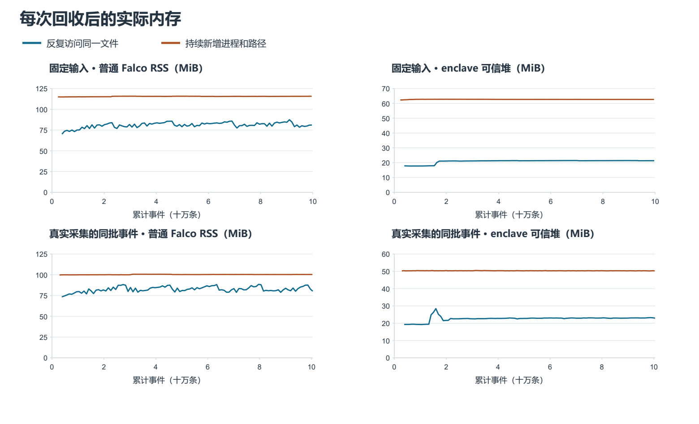

# RAVEN 纯内存回收的百万事件实测

2026-11-21。在 Ubuntu 22.04 x86_64 的独立 QEMU 快照中，使用 4 个虚拟 CPU、6 GiB 内存、Linux 5.15.0-198-generic、普通 Falco 0.45.2、Falco libs 0.26.1 和签名的 Open Enclave SGX Simulation。可信堆配置为 512 MiB。

全套测试使用同一版程序和原定 8 MiB 标准。普通 Falco 重复访问同一文件时有两项超标。固定输入的回收后 RSS 极差为 10.00 MiB，现场输入为 9.63 MiB。后半程首末两次回收的 RSS 分别从 81.80 到 81.03 MiB、从 80.94 到 80.25 MiB，超标体现为中间各周期的波动。

持续新增进程与路径这一负载在固定输入和真实采集两组均通过全部验收条件。

所有组合均通过输入、完整告警、常驻计费和可信堆高水位核验，强制分段为零。两次现场采集的驱动、报文和 ring 丢失计数均为零。

## 原版对照

固定版本 RAVEN full 和 Zeek 6.0.9 重新生成了参考输出。普通 Falco 与 enclave 在默认回收配置下通过了 34 组回归，包含原有差异和 Zeek 抑制过期。原版 RAVEN 使用提交 `3b5fbf5f33e2d1287d3ff0f546023106f787a92e`，Zeek 使用已固定摘要的官方镜像及其 `policy/misc/scan`。

两份归档的 100,000 条旧输入在 1 GiB 验证计费预算下，各有 10 条完整检测记录。两端均与原版逐条、逐字段一致。对照保留输入自带的事件 ID，只归一化运行时随机 ID 和规则安装目录。默认 128 MiB 的长测另外逐条核验回收后的图证据及告警。

短用例覆盖 600 秒的包含边界、空闲推进水位、迟到、重复 ID、旧生命周期回收后的 PID 复用，以及仍有活跃后代的已退出祖先。用超大单条输入和多条同时未完成的规则链分别触发过载，核验了明确的受影响序号和后续恢复。

## 四次相同输入的百万条长测

每次运行保留同一个引擎实例，全程使用默认 128 MiB 高水位和 96 MiB 低水位。事件时间间隔为 1 毫秒，两种模式逐条核对从 1 到 1,000,000 的输入序号，每一万条恰有一次目标告警。

| 负载 | 运行方式 | 事件 | RAVEN 告警 | 回收周期 | 后 50 万条回收后基线范围（MiB） | 基线极差（MiB） | 整进程 RSS 峰值（MiB） | 可信堆高水位（MiB） | 最大整条告警（字节） |
|---|---|---|---|---|---|---|---|---|---|
| 重复访问同一文件 | 普通 Falco | 1,000,000 | 100 | 101 | 77.45–87.45 | 10.00 | 87.48 | — | 1,842,110 |
| 重复访问同一文件 | 签名 enclave | 1,000,000 | 100 | 101 | 21.31–21.44 | 0.13 | 866.41 | 33.68 | 1,842,110 |
| 持续新增进程和路径 | 普通 Falco | 1,000,000 | 100 | 169 | 115.41–115.82 | 0.41 | 115.82 | — | 8,570 |
| 持续新增进程和路径 | 签名 enclave | 1,000,000 | 100 | 169 | 62.66–62.68 | 0.03 | 866.61 | 78.50 | 8,570 |

| 负载 | 运行方式 | 稳态采样连续可回查（秒） | 刚回收后的连续可回查（秒） | 含受保护证据的最远观测距离（秒） | 常驻计费峰值（MiB） | 终点保留事件 | 已回收事件 |
|---|---|---|---|---|---|---|---|
| 重复访问同一文件 | 普通 Falco | 28.73–38.17 | 28.73–28.73 | 59.74 | 127.98 | 31,907 | 968,093 |
| 重复访问同一文件 | 签名 enclave | 28.73–38.17 | 28.73–28.73 | 59.74 | 127.98 | 31,907 | 968,093 |
| 持续新增进程和路径 | 普通 Falco | 16.99–22.76 | 16.99–16.99 | 59.56 | 127.98 | 21,118 | 978,882 |
| 持续新增进程和路径 | 签名 enclave | 16.99–22.76 | 16.99–16.99 | 59.56 | 127.98 | 21,118 | 978,882 |

## 两组真实采集及普通 Falco 同批回放

每种实际负载由签名 enclave 直接消费 Modern eBPF 的 64 MiB 内核 ring。普通 Falco 逐条处理该次采集记录的全部归一化事件。控制程序按内核操作计数，两端独立核对有序的检测输入和完整 Falco 告警。

| 负载 | 运行方式 | 事件 | RAVEN 告警 | 回收周期 | 后 50 万条回收后基线范围（MiB） | 基线极差（MiB） | 整进程 RSS 峰值（MiB） | 可信堆高水位（MiB） | 最大整条告警（字节） |
|---|---|---|---|---|---|---|---|---|---|
| 重复访问同一文件 | 普通 Falco | 1,005,514 | 126 | 103 | 78.84–88.47 | 9.63 | 88.71 | — | 1,927,928 |
| 重复访问同一文件 | 签名 enclave | 1,005,514 | 126 | 103 | 22.66–23.24 | 0.58 | 1013.16 | 39.25 | 1,927,928 |
| 持续新增进程和路径 | 普通 Falco | 1,004,345 | 101 | 133 | 100.25–100.41 | 0.15 | 100.71 | — | 9,155 |
| 持续新增进程和路径 | 签名 enclave | 1,004,345 | 101 | 133 | 50.23–50.43 | 0.19 | 1010.93 | 61.19 | 9,155 |

| 负载 | 运行方式 | 稳态采样连续可回查（秒） | 刚回收后的连续可回查（秒） | 含受保护证据的最远观测距离（秒） | 常驻计费峰值（MiB） | 终点保留事件 | 已回收事件 |
|---|---|---|---|---|---|---|---|
| 重复访问同一文件 | 普通 Falco | 7.63–15.67 | 7.63–12.39 | 59.95 | 127.98 | 29,272 | 976,242 |
| 重复访问同一文件 | 签名 enclave | 7.63–15.67 | 7.63–12.39 | 59.95 | 127.98 | 29,272 | 976,242 |
| 持续新增进程和路径 | 普通 Falco | 11.75–16.00 | 11.75–12.17 | 59.99 | 127.98 | 22,733 | 981,612 |
| 持续新增进程和路径 | 签名 enclave | 11.75–16.00 | 11.75–12.17 | 59.99 | 127.98 | 22,733 | 981,612 |

| 负载 | 现场送入 RAVEN | 采集时长（秒） | 采集期平均归一化事件/秒 | 驱动提交 | 报文提交 | ring 消费 | 驱动丢失 | 报文丢失 | ring 丢弃 | 格式拒绝 | 目标读取告警 |
|---|---|---|---|---|---|---|---|---|---|---|---|
| 重复访问同一文件 | 1,005,514 | 393.4 | 2555.7 | 5,296,666 | 2,348 | 5,299,014 | 0 | 0 | 0 | 0 | 100 |
| 持续新增进程和路径 | 1,004,345 | 556.6 | 1804.5 | 11,421,995 | 2,999 | 11,424,994 | 0 | 0 | 0 | 0 | 100 |

现场同文件负载执行 1,000,000 次写入和 100 次标记读取。新进程负载核验 250,000 个子进程的创建、退出及各自独立文件的创建和写入，并核对 100 次标记读取。采集总数也含同一客体的其他归一化事件。检查使用两端的输入数量、有序 ID 摘要、全部有序输出的 SHA-256、驱动提交数、消费游标和工作负载自身的计数。

同文件组的另外 26 条告警来自客体的 `sshd` 进程，新进程组的另外 1 条来自 `cron`。双端对照覆盖了全部 126 条和 101 条告警。

## 内存、回查和回收口径

每万条采样普通 Falco 全进程 RSS 和 enclave 可信分配器已用字节。两端在回收结束时也采样，稳定性取最后 500,000 条中同一回收阶段的最大值减最小值，通过阈值为 8 MiB。进程峰值取 GNU time 高水位和可用的 RSS 采样最大值中的较高者，JSON 分别保留两个读数。enclave 的分配器高水位包括最后的告警序列化和输出。

连续可回查时间按图证据的完整覆盖范围计算，取当前事件时间水位与覆盖起点的差。表中给出后半程每万条及回收时的采样范围。这些负载先触及了 128 MiB 预算，仍被规则链引用的个别直接证据最远保留到约 60 秒前。已回收事件已经进入检测器，对输入缺失、输出缺失和超预算强制分段另行核对。最大告警按完整 Falco JSONL 整行字节数计算，扣除行尾换行。

每处理 10,000 条的实际内存增量（MiB）

| 累计万条 | 固定输入 · 同文件 · RSS | 固定输入 · 同文件 · 可信堆 | 固定输入 · 新进程 · RSS | 固定输入 · 新进程 · 可信堆 | 现场 · 同文件 · RSS | 现场 · 同文件 · 可信堆 | 现场 · 新进程 · RSS | 现场 · 新进程 · 可信堆 |
|---|---|---|---|---|---|---|---|---|
| 1 | +7.09 | +5.97 | +35.40 | +41.21 | +3.76 | +4.72 | +25.34 | +29.69 |
| 2 | +8.24 | +5.08 | +22.17 | +26.18 | +4.98 | +5.36 | +12.18 | +14.40 |
| 3 | +6.17 | +5.89 | +6.20 | -4.08 | +7.17 | +5.51 | +10.75 | +3.76 |
| 4 | +3.60 | +0.74 | -0.04 | +11.07 | +6.11 | +0.75 | +0.18 | +3.84 |
| 5 | +1.54 | +0.13 | -0.00 | -4.05 | +1.05 | +0.21 | +0.01 | +3.63 |
| 6 | -1.20 | +0.14 | -0.01 | -4.09 | +0.52 | +0.18 | -0.02 | -6.81 |
| 7 | +1.09 | +0.17 | +0.04 | -4.20 | +0.27 | +0.29 | -0.06 | +3.78 |
| 8 | +1.08 | +0.18 | +0.06 | +11.15 | -0.24 | +0.17 | -0.02 | +3.69 |
| 9 | -0.35 | +0.18 | -0.02 | -4.13 | +0.97 | +0.10 | +0.06 | -6.72 |
| 10 | -0.46 | +0.19 | +0.03 | -4.21 | +2.08 | +0.17 | +0.00 | +3.64 |
| 11 | +1.84 | +0.19 | -0.01 | -4.24 | +0.70 | +0.12 | +0.12 | +3.75 |
| 12 | +0.86 | +0.22 | -0.04 | +11.15 | -2.71 | +0.31 | -0.00 | -6.84 |
| 13 | +1.04 | +0.22 | +0.03 | -4.18 | +1.49 | +0.23 | -0.03 | +3.75 |
| 14 | +0.47 | +0.23 | +0.03 | -4.26 | -0.57 | +0.22 | +0.00 | -6.77 |
| 15 | +0.41 | +0.21 | +0.05 | +11.16 | +6.59 | +7.57 | +0.02 | +3.69 |
| 16 | -1.27 | +0.21 | -0.05 | -4.17 | -1.43 | +2.34 | -0.04 | +3.72 |
| 17 | +0.86 | +2.35 | +0.08 | -4.21 | -1.02 | -6.65 | +0.05 | -6.81 |
| 18 | +0.66 | +1.13 | -0.04 | -4.27 | +0.99 | -1.10 | +0.02 | +3.73 |
| 19 | -1.30 | +0.19 | +0.02 | +11.19 | -1.47 | -2.24 | -0.23 | +3.75 |
| 20 | +0.79 | +0.20 | +0.02 | -4.19 | +1.16 | +0.36 | +0.23 | -6.70 |
| 21 | +0.89 | +0.23 | -0.02 | -4.26 | -1.25 | +0.22 | -0.09 | +3.57 |
| 22 | +0.88 | +0.21 | +0.04 | -4.19 | +3.80 | +1.28 | +0.18 | +3.71 |
| 23 | -0.48 | +0.20 | -0.04 | +11.16 | -4.95 | +0.01 | -0.07 | -6.72 |
| 24 | -0.84 | -4.09 | +0.48 | -4.21 | +4.09 | +0.19 | -0.09 | +3.69 |
| 25 | +1.01 | +0.10 | +0.07 | -4.26 | -1.18 | +0.22 | +0.10 | +3.80 |
| 26 | -0.04 | +0.21 | +0.03 | +11.17 | +5.09 | +0.21 | -0.10 | -6.79 |
| 27 | -0.33 | +0.23 | -0.00 | -4.20 | -4.14 | +0.30 | +0.12 | +3.68 |
| 28 | -0.67 | +0.22 | -0.04 | -4.24 | +4.96 | +0.23 | -0.11 | +3.70 |
| 29 | +0.75 | +0.20 | +0.06 | -4.24 | -4.58 | +0.23 | +0.05 | -6.76 |
| 30 | -0.48 | +0.19 | -0.04 | +11.18 | +2.01 | +0.08 | +0.01 | +3.71 |
| 31 | +0.13 | +0.19 | +0.09 | -4.20 | -0.97 | +0.12 | +0.58 | -6.67 |
| 32 | +0.11 | +0.22 | +0.00 | -4.27 | +1.18 | +0.30 | -0.05 | +3.65 |
| 33 | -0.37 | +0.22 | -0.02 | -4.15 | -0.81 | +0.21 | +0.09 | +3.76 |
| 34 | +1.55 | +0.21 | +0.00 | +11.14 | +0.39 | +0.14 | +0.00 | -6.81 |
| 35 | +0.58 | +0.18 | -0.23 | -4.22 | -4.68 | -3.46 | -0.12 | +3.75 |
| 36 | -0.89 | +0.19 | -0.04 | -4.27 | +0.38 | +0.29 | -0.00 | +3.74 |
| 37 | +0.19 | +0.21 | +0.15 | +11.19 | +0.46 | +0.27 | +0.10 | -6.82 |
| 38 | -0.72 | +0.20 | -0.07 | -4.19 | +2.34 | +0.22 | -0.09 | +3.69 |
| 39 | +1.81 | +0.20 | -0.04 | -4.22 | +0.00 | +0.13 | +0.07 | +3.72 |
| 40 | -0.29 | +0.22 | +0.05 | -4.20 | +0.57 | +0.27 | +0.01 | -6.73 |
| 41 | +0.47 | +0.18 | +0.03 | +11.18 | +0.36 | +0.16 | -0.07 | +3.73 |
| 42 | -0.70 | +0.20 | -0.07 | -4.18 | -2.67 | +0.23 | +0.11 | +3.70 |
| 43 | +0.93 | +0.18 | -0.06 | -4.26 | -0.28 | +0.22 | -0.12 | -6.81 |
| 44 | +0.20 | +0.20 | +0.14 | +11.19 | -0.17 | +0.30 | +0.02 | +3.68 |
| 45 | +0.55 | +0.20 | -0.04 | -4.16 | +5.48 | +0.33 | +0.03 | -6.67 |
| 46 | +0.27 | +0.21 | -0.06 | -4.19 | +0.30 | +0.12 | -0.36 | +3.67 |
| 47 | -2.97 | -4.12 | +0.11 | -4.26 | -0.96 | +0.01 | +0.06 | +3.77 |
| 48 | -0.26 | +0.05 | +0.02 | +11.20 | -2.11 | +0.16 | -0.02 | -6.83 |
| 49 | -0.91 | +0.21 | +0.09 | -4.17 | -0.70 | +0.21 | -0.02 | +3.74 |
| 50 | +1.76 | +0.20 | -0.08 | -4.22 | +2.00 | +0.24 | +0.02 | +3.77 |
| 51 | -1.18 | +0.20 | +0.09 | -4.18 | +0.90 | +0.28 | -0.02 | -6.74 |
| 52 | +0.09 | +0.18 | +0.02 | +11.18 | -0.52 | +0.23 | -0.10 | +3.67 |
| 53 | +1.65 | +0.20 | -0.12 | -4.18 | +0.38 | +0.31 | +0.14 | +3.79 |
| 54 | -3.02 | +0.20 | +0.07 | -4.25 | -2.75 | -3.59 | +0.00 | -6.85 |
| 55 | +1.69 | +0.21 | +0.05 | +11.18 | -1.83 | +0.09 | -0.04 | +3.73 |
| 56 | +0.65 | +0.19 | -0.12 | -4.16 | +2.57 | +0.24 | -0.03 | +3.81 |
| 57 | +1.73 | +0.20 | -0.01 | -4.18 | -1.31 | +0.21 | +0.04 | -6.82 |
| 58 | -1.05 | +0.19 | -0.19 | -4.25 | +1.06 | +0.31 | +0.02 | +3.75 |
| 59 | +0.16 | +0.20 | -0.04 | +11.20 | +0.57 | +0.22 | +0.05 | +3.69 |
| 60 | +0.05 | +0.20 | +0.14 | -4.17 | +1.89 | +0.26 | -0.01 | -6.72 |
| 61 | -0.14 | +0.19 | -0.07 | -4.22 | -3.22 | +0.20 | +0.02 | +3.71 |
| 62 | +0.55 | +0.19 | +0.08 | -4.18 | +3.33 | +0.13 | +0.04 | -6.77 |
| 63 | +0.20 | +0.20 | -0.21 | +11.18 | -2.83 | +0.29 | -0.01 | +3.76 |
| 64 | -1.30 | +0.20 | +0.06 | -4.18 | +4.18 | +0.13 | -0.20 | +3.76 |
| 65 | +0.62 | +0.20 | +0.08 | -4.25 | -1.91 | +0.09 | +0.16 | -6.84 |
| 66 | +1.27 | +0.20 | +0.06 | +11.17 | -2.06 | +0.21 | +0.03 | +3.69 |
| 67 | -0.32 | +0.19 | -0.09 | -4.16 | +0.79 | +0.31 | -0.12 | +3.82 |
| 68 | -0.04 | +0.19 | +0.08 | -4.18 | -0.36 | +0.30 | +0.09 | -6.83 |
| 69 | +0.84 | +0.19 | +0.03 | -4.25 | -0.32 | +0.20 | -0.12 | +3.78 |
| 70 | -2.70 | -4.12 | +0.02 | +11.20 | +1.55 | +0.15 | +0.04 | +3.75 |
| 71 | -0.38 | +0.03 | -0.06 | -4.17 | -0.91 | +0.18 | +0.06 | -6.78 |
| 72 | -0.26 | +0.19 | +0.14 | -4.23 | -1.51 | -3.62 | -0.14 | +3.71 |
| 73 | +0.34 | +0.19 | -0.18 | -4.18 | -0.16 | +0.28 | +0.19 | +3.70 |
| 74 | -1.30 | +0.20 | +0.00 | +11.17 | -1.42 | +0.15 | -0.01 | -6.70 |
| 75 | +1.27 | +0.20 | +0.10 | -4.18 | +0.14 | +0.32 | -0.08 | +3.71 |
| 76 | -0.89 | +0.19 | -0.06 | -4.25 | +2.18 | +0.19 | +0.09 | -6.77 |
| 77 | +0.07 | +0.20 | +0.09 | +11.17 | +2.84 | +0.17 | -0.06 | +3.65 |
| 78 | +2.21 | +0.18 | -0.16 | -4.16 | -1.50 | +0.12 | -0.02 | +3.83 |
| 79 | +0.10 | +0.21 | +0.08 | -4.18 | -1.30 | +0.25 | +0.02 | -6.81 |
| 80 | -1.42 | +0.18 | +0.04 | -4.25 | +2.13 | +0.23 | -0.05 | +3.79 |
| 81 | +1.02 | +0.20 | -0.03 | +11.19 | +1.66 | +0.29 | +0.04 | +3.64 |
| 82 | -0.23 | +0.20 | +0.10 | -4.17 | -2.14 | +0.01 | +0.04 | -6.78 |
| 83 | +0.27 | +0.21 | -0.12 | -4.23 | -2.82 | +0.33 | -0.00 | +3.79 |
| 84 | -0.08 | +0.20 | +0.04 | -4.18 | +2.53 | +0.19 | -0.06 | +3.72 |
| 85 | +0.36 | +0.19 | -0.04 | +11.18 | -1.92 | +0.20 | +0.03 | -6.75 |
| 86 | +0.46 | +0.19 | +0.02 | -4.18 | +2.27 | +0.30 | +0.01 | +3.76 |
| 87 | -1.16 | +0.19 | +0.02 | -4.24 | -0.36 | +0.08 | -0.09 | +3.67 |
| 88 | +1.00 | +0.19 | +0.07 | +11.18 | +0.30 | +0.17 | +0.03 | -6.75 |
| 89 | -0.21 | +0.20 | -0.03 | -4.17 | -1.09 | +0.29 | +0.04 | +3.78 |
| 90 | +0.20 | +0.19 | -0.12 | -4.18 | +1.04 | +0.14 | +0.02 | -6.80 |
| 91 | +1.78 | +0.19 | +0.16 | -4.24 | -3.97 | -3.48 | -0.06 | +3.75 |
| 92 | -1.68 | +0.18 | +0.08 | +11.19 | -1.06 | +0.19 | -0.04 | +3.71 |
| 93 | -2.06 | -4.13 | -0.23 | -4.17 | +3.28 | +0.21 | +0.15 | -6.80 |
| 94 | -0.49 | +0.04 | +0.20 | -4.23 | -3.89 | +0.22 | +0.00 | +3.80 |
| 95 | -0.58 | +0.18 | -0.06 | -4.18 | +3.18 | +0.13 | -0.02 | +3.73 |
| 96 | +0.84 | +0.20 | -0.08 | +11.17 | +0.57 | +0.21 | +0.02 | -6.72 |
| 97 | -0.18 | +0.19 | +0.16 | -4.18 | +2.09 | +0.22 | -0.02 | +3.71 |
| 98 | +0.23 | +0.20 | +0.02 | -4.24 | +0.85 | +0.34 | -0.04 | +3.72 |
| 99 | -0.11 | +0.19 | +0.03 | +11.17 | +0.79 | +0.32 | +0.03 | -6.76 |
| 100 | +0.96 | +0.15 | -0.07 | -4.31 | -2.84 | -0.02 | -0.04 | +3.75 |

完整记录含二进制指纹、输入和告警摘要、每次采样、回收原因、最大检测载荷、实测阈值判断及真实采集计数。[原始测量 JSON](retention-results.json) · [实施方案和复现命令](../../../poc/falco/RAVEN-历史回收.md)

按用户选择，两份真实采集的归一化事件文件、回放链接和临时压缩包已经清理。验证记录保留两个输入指纹及 200 次标记读取的证据范围。测量 JSON 在客体和工作区的 SHA-256 均为 `020791904b83adeb354c97be13acaf4b735ba6d9b442e1ff0da3e213ab44e354`。
