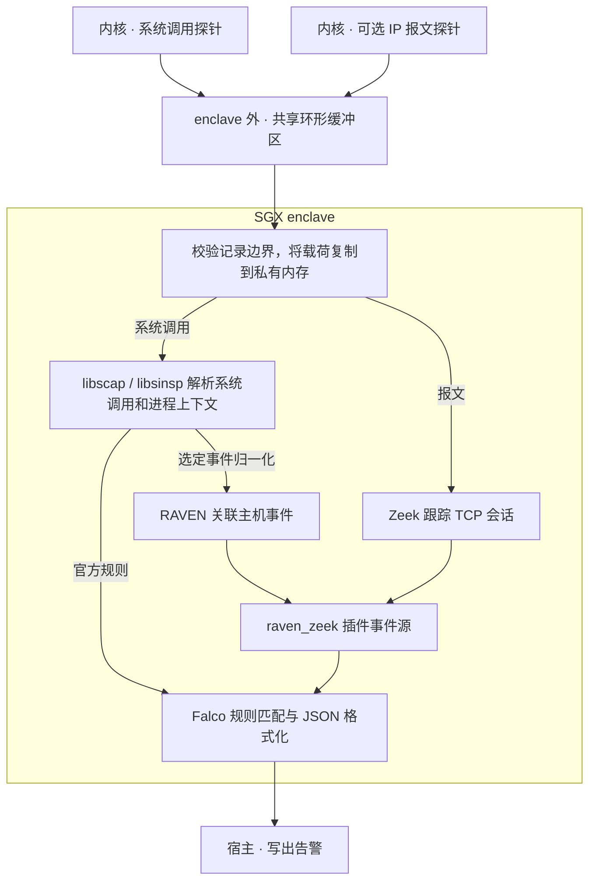

# sgx-ebpf-falco 项目实现与测试总结

这个项目在 Linux 上采集系统调用和网络报文，把事件解析、规则匹配和告警生成放进 Intel SGX enclave（由处理器隔离的内存区域）。内核里的 eBPF 探针负责观察发生了什么，enclave 里的 Falco 负责判断它是否命中规则，宿主程序负责启动采集和输出 JSON 告警。

项目开发的程序是 **Falco**。它使用自己的 Modern eBPF 驱动，能够实时检测，也能用录下的输入重放一次检测，enclave 基于 Open Enclave 构建。仓库里另有一个前期概念验证 **GETPID**，只观察一个测试进程调用 `getpid()`，用 Intel SGX SDK 量出从内核环形缓冲区向 enclave 传送一条事件的代价，不随 Falco 同步更新。[Falco 实时宿主](poc/falco/live/live_host.cpp) · [Falco 回放入口](poc/falco/replay_host.cpp) · [GETPID 宿主](poc/host/main.cpp)

## 一条事件怎样变成告警

在固定测试轨迹里，线程 101 和 102 各有一次启动 shell 的 `execve`。Falco 结合轨迹中的进程信息判断，两次都命中了官方规则 `Run shell untrusted`。两份输出的前两行都是 JSON 告警，可以逐字段对照规则名、线程号、时间戳和文本。普通 Falco 在文件末尾另附计数摘要。普通 Falco 和硬件 enclave 均启用了 25 条规则，这两条告警的顺序与完整 JSON 一致。[轨迹生成代码](poc/falco/fixture.py) · [普通 Falco 输出](results/aliyun-c7t-large/runs/20261123T073338Z-31ff86016fe5/raw/falco-offline-r02/native-alerts.jsonl) · [硬件 enclave 输出](results/aliyun-c7t-large/runs/20261123T073338Z-31ff86016fe5/raw/falco-offline-r02/sgx-alerts.jsonl)

实时运行时，输入来自正在工作的内核。下图中的 RAVEN 和 Zeek 分支由配置开启。



1. **建立采集现场。** `falco-live` 加载签名镜像、配置和 YAML 规则，从 Linux 的 `/proc` 生成初始进程快照。这样，即使进程在监控启动前就已存在，解析器也有起始上下文。宿主核对所有参与采集的 CPU 共用同一个 ring，把缓冲区和控制页映射进地址空间，在 enclave 消费者就绪后启动探针。[宿主启动与映射](poc/falco/live/live_host.cpp) · [镜像与规则加载](poc/falco/host.cpp)
2. **从共享内存取走记录。** 宿主先调用 `falco_live_setup` 校验映射和快照，再让采集线程和分析线程分别通过 ECALL（从宿主进入 enclave 的调用）进入 `falco_live_run`，启用 raven_zeek 时还有第三个检测线程。每个线程在自己的 ECALL 里一直运行到停止。采集线程持续读取生产游标，遇到尚未写完的记录就等待，遇到丢弃标志就跳过。它核对长度与边界，把有效载荷成批复制到 enclave 私有块，写回消费游标，再交给分析线程在私有副本上解析。ring 读空时默认调出 enclave 退避睡眠。停止时先停探针，再依次排空 ring、私有块和宿主输出队列，最后由 `falco_live_finish` 输出统计。ECALL 次数少并不意味着没有复制，每条有效记录仍要复制一次。2026-11-25 的最新硬件批次运行的就是这一结构，上一批运行的 `31ff860` 还是单个 `falco_live` ECALL、单线程忙等。[跨边界接口](poc/falco/Falco.edl) · [可信消费循环](poc/falco/trusted/enclave.cpp)
3. **执行规则。** libscap 读取底层记录，libsinsp 还原进程、文件描述符等上下文，再把事件交给 Falco 0.45.2 的 `falco_engine`。开启扩展后，`RavenSyscalls::translate` 会将选定事件转换为进程启动、文件访问等记录，RAVEN 用进程关系和时间顺序关联行为。另一条输入是同一 ring 里的 IP 报文，Zeek 的 C++ 检测逻辑根据 TCP 会话识别地址和端口扫描。两者把结果交给 `raven_zeek` 事件源，再由插件 YAML 规则输出告警。固定版本的上游 RAVEN 和 Zeek 用于独立比对。[主机事件转换](poc/falco/trusted/raven_syscalls.cpp) · [RAVEN](poc/falco/plugin/raven.cpp) · [Zeek](poc/falco/plugin/zeek.cpp) · [插件规则](poc/falco/plugin/rules.yaml)
4. **输出与回放。** enclave 内的 `Detector::process` 匹配规则并格式化 JSON，通过 `falco_emit` 将告警交给宿主写到标准输出。现场可选录制系统调用轨迹（SCAP）、RAVEN 归一化事件（JSONL）和报文（PCAP）。离线程序 `falco-sgx` 读取这些文件，与实时程序复用同一签名镜像。固定输入后，可以逐条比较两种执行方式的规则匹配和格式化结果。采集阶段的丢失另由驱动和 ring 计数核对。[告警输出](poc/falco/trusted/enclave.cpp) · [回放入口](poc/falco/replay_host.cpp) · [同输入对照脚本](poc/falco/replay.sh)

RAVEN 的关联规则需要保存历史。它默认保留最近 600 秒的证据，常驻状态的计费接近 128 MiB 时优先回收较早且可释放的证据，目标为 96 MiB。告警可带上回收后仍可追溯的时间边界。这项内部预算与后面实测的整个 enclave 可信堆用量分别统计。[RAVEN 历史回收设计](poc/falco/RAVEN-历史回收.md)

## 在真实硬件上做了什么

最新的硬件批次于 2026-11-25 在阿里云 `ecs.c7t.xlarge` 上完成，基于提交 `13d592774b63` 及随批次保存的改动（线程命名和按间隔输出的驱动计数）。实例为 Ubuntu 22.04.5、内核 `5.15.0-198-generic`、Xeon Platinum 8369B 的 2 核 4 线程，客体可见的 EPC（供 enclave 使用的加密页区域）为 3,968 MiB。Falco 在 Windows 本机的 QEMU 客体中以 `FALCO_SGX_HARDWARE=ON`、Release 配置构建并签名，再传到 ECS 运行。这一批把 RAVEN 和 Zeek 分开测量，每个测试点运行一次 30 秒，不含告警一致性对照（RQ1）和 GETPID。[实测报告](results/aliyun-c7t-xlarge/runs/20261125T130226Z-13d592774b63/REPORT.md) · [实际构建、环境与签名记录](results/aliyun-c7t-xlarge/runs/20261125T130226Z-13d592774b63/record.md)

下文的配置记号：普通 Falco 为原生运行的 Falco 0.45.2；S1 为 SGX 官方规则；S2、S3、S4 在 S1 上分别加 RAVEN、Zeek、两者；S1-spin 把 ring 读空时的等待改为忙等。

| 要回答的问题 | 怎么测，得到了什么 |
| --- | --- |
| 跑起来的确实是非调试 enclave 吗？ | 读取运行中 enclave 的本地 REPORT。普通镜像和 E7 内存探针镜像都是 `DEBUG=0`，镜像度量 `MRENCLAVE` 和签名者标识 `MRSIGNER` 均与签名产物匹配。[普通镜像预检](results/aliyun-c7t-xlarge/runs/20261125T130226Z-13d592774b63/preflight/preflight.json) · [探针镜像预检](results/aliyun-c7t-xlarge/runs/20261125T130226Z-13d592774b63/preflight-probe/preflight.json) |
| 系统调用吞吐能否达到 10 万条/秒？ | 反复打开、关闭 `/dev/null`。S1 在 20 万条/秒档零丢失，实收 196,979 条/秒；普通 Falco 在约 79 万条/秒仍零丢失。加入 RAVEN 后，S2、S4 在 5 万档零丢失，6.25 万档开始丢失。[系统调用吞吐](results/aliyun-c7t-xlarge/runs/20261125T130226Z-13d592774b63/summary/e1.csv) |
| Zeek 的报文处理上限多高？ | 在回环上建立 TCP 短连接。S3 在 23,270 连接/秒、247,965 报文/秒时仍无丢失。S2 的零丢失边界在 1.4 万–1.6 万连接/秒，S4 降到 1 万–1.2 万。[报文吞吐](results/aliyun-c7t-xlarge/runs/20261125T130226Z-13d592774b63/summary/e2.csv) |
| 回放成本如何随输入规模变化？ | 普通 Falco 与 SGX 回放 60 至 60 万条固定事件。60 条时总耗时分别为 0.187 和 3.703 秒，SGX 约 3.3 秒花在就绪前。30 万条时为 9.951 和 5.416 秒，60 万条时为 20.633 和 7.118 秒。每对运行的规范化告警摘要相同。[回放明细](results/aliyun-c7t-xlarge/runs/20261125T130226Z-13d592774b63/e8/summary.csv) |
| 长会话能控制内存吗？ | RAVEN 分别持续处理重复路径、持续新增进程与路径两种负载，各 100 万条，硬件可信堆峰值为 33.95 和 78.56 MiB，后半程同一回收阶段的基线极差为 0.14 和 0.03 MiB。Zeek 处理 1,180,016 个包，超时回收后可信堆从 115.84 降到 69.46 MiB。[内存测试](results/aliyun-c7t-xlarge/runs/20261125T130226Z-13d592774b63/e7/summary.json) |

### 现场性能与代价

HTTP 业务测试使用两条本机持久连接和 1 KiB 响应。告警延迟在约 20 个 HTTP 请求/秒的低负载下测量，每 0.05 秒发出一个标记，从发出标记到宿主读到告警使用同一单调时钟。空闲开销在没有负载时测 30 秒。CPU 以一个逻辑 CPU 为 100%，正式采样关闭轨迹录制。[负载与计时口径](results/aliyun-c7t-xlarge/README.md)

| 配置 | 最高零丢失档实收（条/秒） | HTTP 请求/秒（较无监控降幅） | 低负载告警 p99 | 空闲 CPU |
| --- | ---: | ---: | ---: | ---: |
| 无监控 | — | 9,939（—） | — | — |
| 普通 Falco | 792,244 | 9,810（1.3%） | 30.11 ms | 0.17% |
| S1 官方规则 | 196,979 | 8,792（11.5%） | 29.87 ms | 0.13% |
| S2 + RAVEN | 50,093 | 8,207（17.4%） | 30.07 ms | 1.07% |
| S3 + Zeek | 197,826 | 8,222（17.3%） | 29.51 ms | 0.27% |
| S4 + RAVEN + Zeek | 49,778 | 8,143（18.1%） | 29.78 ms | 1.10% |
| S1-spin 忙等 | — | — | 0.57 ms | 100.16% |

官方规则达到了持续十万条/秒且零丢失的目标。S1、S3 的两个二分点都已丢失，零丢失边界分别在 20 万–52.3 万和 20 万–50.6 万条/秒之间。S2、S4 受单个检测线程限制：每条 RAVEN 输入约耗 45–65 µs 检测线程 CPU，Zeek 每个报文约 1 µs。RAVEN 和 Zeek 共用这个线程，所以单独启用 Zeek 不降低短连接容量，与 RAVEN 合用后边界从 1.4 万–1.6 万降到 1 万–1.2 万连接/秒。按 CPU 增量看，合用低于两项单独增量之和；按容量看，合用的损失超过两者之和。[现场吞吐与丢失](results/aliyun-c7t-xlarge/runs/20261125T130226Z-13d592774b63/REPORT.md#e1系统调用吞吐) · [HTTP 分组数据](results/aliyun-c7t-xlarge/runs/20261125T130226Z-13d592774b63/summary/e4.csv)

S1 每个 HTTP 请求处理 5.32 条系统调用记录，普通 Falco 为 5.24 条。按 Falco 0.45.2 的规则选择 72 个系统调用后，SGX 与原生处理的事件量已经一致。S1 的吞吐降幅比普通 Falco 多约 10 个百分点，RAVEN、Zeek 各再增加约 6 个百分点。

默认的退避睡眠让 SGX 的低负载 p99 与普通 Falco 相同，都在 30 ms 左右，接近 30 ms 的退避上限。只有忙等把 p99 降到 2 ms 以下，代价是空闲时也占满一个逻辑 CPU。持续负载下 ring 很少读空，退避睡眠的 p99 也低于 2 ms（1.31–1.46 ms），采集 CPU 为 9.5%–28.1%，忙等为 108.9%–179.3%。`buffered_outputs: true` 恢复按 64 KiB 刷新后，低负载 p99 为 1.81 秒。[当前输出与空闲配置](poc/falco/README.md#modern-ebpf-实时直读) · [告警延迟](results/aliyun-c7t-xlarge/runs/20261125T130226Z-13d592774b63/summary/e5.csv)

测量期间服务器上常驻的阿里云盾代理会触发少量 RAVEN 告警，经逐秒评估，对测量的干扰可忽略。每个测试点只运行一次，相近配置之间零点几个百分点的差值不能判断是否可重复。[背景干扰评估](results/aliyun-c7t-xlarge/runs/20261125T130226Z-13d592774b63/REPORT.md#后台告警与二分补测)

### 告警一致性与上一批

现场告警一致性对照只在 2026-11-23 的 `ecs.c7t.large` 批次做过。当时官方规则现场用例收到 3,408 条记录，驱动丢失为 0；完整配置的一轮现场检测收到 10,113 条系统调用记录和 121 个报文，驱动和报文均零丢失；另一次录制的 287 条归一化事件和 92 个报文，在普通 Falco 和 SGX 回放中均复现现场检测结果。这些结果来自旧的 `31ff860`，没有在当前代码上重测。[官方规则现场记录](results/aliyun-c7t-large/runs/20261123T073338Z-31ff86016fe5/raw/falco-live-official-r01/live-check.json) · [完整检测与回放对照](results/aliyun-c7t-large/runs/20261123T073338Z-31ff86016fe5/raw/falco-live-detectors-r01/comparison.json)

该批的 Falco 性能数据已过时。它在 2 vCPU 上运行 `31ff860`，仍是单个 ECALL 忙等、订阅全部系统调用、告警按 64 KiB 刷新，当时 SGX 每个 HTTP 请求处理约 15 条记录，只启用官方规则时首条告警等待约 8 秒。当前源码已修正这些行为，并由最新批次复测确认。[上一批报告（已过时）](results/aliyun-c7t-large/runs/20261123T073338Z-31ff86016fe5/REPORT.md)

## 前期实验：GETPID

开发 Falco 之前，项目先用 GETPID 单独测量从 ring 向 enclave 传送事件的代价。Falco 的实时入口沿用了直读的思路，由 enclave 在常驻 ECALL 里直接读取映射的 ring，但线程结构、批量、空闲等待和记录格式都不同，下面的 ECALL 次数和 CPU 占用不能直接套用到 Falco。发生器显式调用 `getpid()`。探针只记录目标进程，为每次调用编序号，尝试向 1 MiB ring 提交一条 256 字节记录。这样能分别数清发生了多少次调用、多少次因 ring 空间不足而提交失败、多少条通过了消费者校验。[内核探针](poc/bpf/probe.bpf.c) · [记录格式](poc/include/event.h) · [校验逻辑](poc/include/event_logic.h)

| 模式 | 一条记录经过的路径 |
| --- | --- |
| `baseline`、`host` | 前者只运行发生器。后者加载探针，由普通用户态回调校验记录。这两组给出发生和采集的基线。 |
| `ecall`、`batch` | 宿主读 ring，逐条送入 enclave，或先攒成最多 64 条的一批再送入。 |
| `step`、`direct` | enclave 直接读映射。前者每次调用最多消费 64 条，后者一次进入后持续消费到停采、排空。 |

GETPID 的硬件结果来自 2026-11-23 的 `ecs.c7t.large` 批次。GETPID 代码此后没有改动，最新批次没有重测。该批中，GETPID 使用 Intel SGX SDK 2.25 的 `SGX_MODE=HW SGX_DEBUG=0`，按 `DisableDebug=1` 签名，在 ECS 上编译。在目标每秒 10 万次调用的 60 秒轮次里，逐条、批量、常驻直读的数据 ECALL 次数中位数分别为 **6,000,000、499,220 和 1**。三者的消费者 CPU 分别约为 **65.0%、12.2% 和 99.8%**，100% 相当于占用一个逻辑 CPU。直读省下了反复进入 enclave 的开销，持续轮询也有明确的 CPU 成本。[GETPID enclave 实现](poc/enclave/Enclave.cpp) · [逐轮计数与 CPU](results/aliyun-c7t-large/runs/20261123T073338Z-31ff86016fe5/summary/getpid-trials.csv)

丢失核对方面，五种采集模式各送 10,003 条，全部处理。人为让消费者暂停 3 秒后，20,000 次尝试中有 16,029 次未能预留空间，其余 3,971 条全部排空。正式矩阵包含 75 个 60 秒样本，十万次调用/秒档的四种正式采集模式共 20/20 轮零丢失。[满环原始计数](results/aliyun-c7t-large/runs/20261123T073338Z-31ff86016fe5/raw/getpid-overflow-direct-r01/stdout.json) · [分组结果](results/aliyun-c7t-large/runs/20261123T073338Z-31ff86016fe5/summary/getpid-groups.csv)

## 从哪里动手复现

在配好 SGX 硬件运行库的 Linux 上，从仓库根目录运行以下命令可复现开头的两条告警。`FALCO_PACKAGE` 指向 Falco 发行包的 `deps/package`，`FALCO_BUILD` 指向含硬件宿主 `bin/falco-sgx` 和签名镜像的构建目录。第三个参数是新的输出目录。完成后查看其中的 `comparison.json`，预期为 `pass=true`、`matched_alerts=2`。[最新批次的构建命令](results/aliyun-c7t-xlarge/runs/20261125T130226Z-13d592774b63/evidence/build.sh) · [上一批的回放脚本](results/aliyun-c7t-large/runs/20261123T073338Z-31ff86016fe5/evidence/retry-falco.sh)

```bash
bash poc/falco/replay.sh "$FALCO_PACKAGE" "$FALCO_BUILD" hw-replay-01
```

## 验证边界与复核入口

- **硬件身份与输入来源是两个问题。** 本地 REPORT 验证了正在运行的 enclave 身份和调试属性。ring、初始快照及规则来自 enclave 外部。边界检查和私有副本保护解析过程，每条输入的内核来源仍缺少独立认证。[Falco ring 测试](poc/falco/live/ring_test.cpp)
- **历史测试有各自的环境。** 仓库还包含容器元数据、Kubernetes、DNS、固定上游回归和 MOAT 内核实验。例如，历史补充检测用例有 79/91 项与固定上游一致。MOAT 曾在 QEMU 中完成 SGX Simulation 功能验证。两批 ECS 客体的 PKS 位均为 0，缺少该硬件隔离对照的运行条件。[历史验收](results/falco/acceptance.md) · [最新批次预检](results/aliyun-c7t-xlarge/runs/20261125T130226Z-13d592774b63/preflight/preflight.json)
- **复核数据从批次记录开始。** 最新批次的 `trials.csv` 按轮次指向原始输出，`summary/` 保存汇总表，`evidence/` 保存源码补丁、构建与执行脚本，`archives/` 保存不直接入库的大文件。从 GitHub 获取数据后，在批次目录运行下方命令，先解压 `archives/` 中的 12 个文件，再用服务器生成的清单核对全部 1,045 个原始文件。上一批另有自己的复核脚本。[压缩包与还原命令](results/aliyun-c7t-xlarge/runs/20261125T130226Z-13d592774b63/archives/README.md) · [逐轮索引](results/aliyun-c7t-xlarge/runs/20261125T130226Z-13d592774b63/trials.csv) · [批次记录](results/aliyun-c7t-xlarge/runs/20261125T130226Z-13d592774b63/record.md) · [上一批复核脚本](results/aliyun-c7t-large/runs/20261123T073338Z-31ff86016fe5/evidence/audit.py)

```bash
cd results/aliyun-c7t-xlarge/runs/20261125T130226Z-13d592774b63
for f in $(cd archives && find e7 e8 -name '*.xz'); do xz -dc "archives/$f" > "${f%.xz}"; done
sha256sum --quiet -c SHA256SUMS
```
