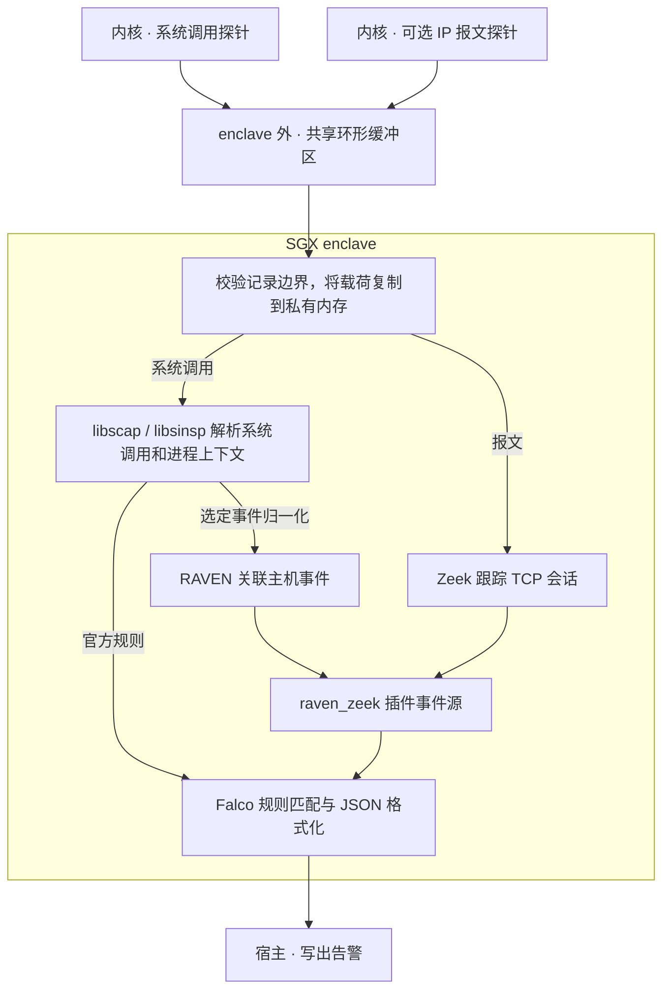

# sgx-ebpf-falco 项目实现与测试总结

这个项目在 Linux 上采集系统调用和网络报文，把事件解析、规则匹配和告警生成放进 Intel SGX enclave（由处理器隔离的内存区域）。内核里的 eBPF 探针负责观察发生了什么，enclave 里的 Falco 负责判断它是否命中规则，宿主程序负责启动采集和输出 JSON 告警。

项目开发的程序是 **Falco**。它使用自己的 Modern eBPF 驱动，能够实时检测，也能用录下的输入重放一次检测，enclave 基于 Open Enclave 构建。仓库里另有一个前期概念验证 **GETPID**，只观察一个测试进程调用 `getpid()`，用 Intel SGX SDK 量出从内核环形缓冲区向 enclave 传送一条事件的代价，不随 Falco 同步更新。[Falco 实时宿主](poc/falco/live/live_host.cpp) · [Falco 回放入口](poc/falco/replay_host.cpp) · [GETPID 宿主](poc/host/main.cpp)

## 一条事件怎样变成告警

在固定测试轨迹里，线程 101 和 102 各有一次启动 shell 的 `execve`。Falco 结合轨迹中的进程信息判断，两次都命中了官方规则 `Run shell untrusted`。两份输出的前两行都是 JSON 告警，可以逐字段对照规则名、线程号、时间戳和文本。普通 Falco 在文件末尾另附计数摘要。普通 Falco 和硬件 enclave 均启用了 25 条规则，这两条告警的顺序与完整 JSON 一致。[轨迹生成代码](poc/falco/fixture.py) · [普通 Falco 输出](results/aliyun-c7t-large/runs/20261123T073338Z-31ff86016fe5/raw/falco-offline-r02/native-alerts.jsonl) · [硬件 enclave 输出](results/aliyun-c7t-large/runs/20261123T073338Z-31ff86016fe5/raw/falco-offline-r02/sgx-alerts.jsonl)

实时运行时，输入来自正在工作的内核。下图中的 RAVEN 和 Zeek 分支由配置开启。



1. **建立采集现场。** `falco-live` 加载签名镜像、配置和 YAML 规则，从 Linux 的 `/proc` 生成初始进程快照。这样，即使进程在监控启动前就已存在，解析器也有起始上下文。宿主核对所有参与采集的 CPU 共用同一个 ring，把缓冲区和控制页映射进地址空间，在 enclave 消费者就绪后启动探针。[宿主启动与映射](poc/falco/live/live_host.cpp) · [镜像与规则加载](poc/falco/host.cpp)
2. **从共享内存取走记录。** 宿主先调用 `falco_live_setup` 校验映射和快照，再让采集线程和分析线程分别通过 ECALL（从宿主进入 enclave 的调用）进入 `falco_live_run`，启用 raven_zeek 时还有第三个检测线程。每个线程在自己的 ECALL 里一直运行到停止。采集线程持续读取生产游标，遇到尚未写完的记录就等待，遇到丢弃标志就跳过。它核对长度与边界，把有效载荷成批复制到 enclave 私有块，写回消费游标，再交给分析线程在私有副本上解析。ring 读空时默认调出 enclave 退避睡眠。停止时先停探针，再依次排空 ring、私有块和宿主输出队列，最后由 `falco_live_finish` 输出统计。ECALL 次数少并不意味着没有复制，每条有效记录仍要复制一次。本次硬件批次运行的 `31ff860` 还是单个 `falco_live` ECALL、单线程忙等。[跨边界接口](poc/falco/Falco.edl) · [可信消费循环](poc/falco/trusted/enclave.cpp)
3. **执行规则。** libscap 读取底层记录，libsinsp 还原进程、文件描述符等上下文，再把事件交给 Falco 0.45.2 的 `falco_engine`。开启扩展后，`RavenSyscalls::translate` 会将选定事件转换为进程启动、文件访问等记录，RAVEN 用进程关系和时间顺序关联行为。另一条输入是同一 ring 里的 IP 报文，Zeek 的 C++ 检测逻辑根据 TCP 会话识别地址和端口扫描。两者把结果交给 `raven_zeek` 事件源，再由插件 YAML 规则输出告警。固定版本的上游 RAVEN 和 Zeek 用于独立比对。[主机事件转换](poc/falco/trusted/raven_syscalls.cpp) · [RAVEN](poc/falco/plugin/raven.cpp) · [Zeek](poc/falco/plugin/zeek.cpp) · [插件规则](poc/falco/plugin/rules.yaml)
4. **输出与回放。** enclave 内的 `Detector::process` 匹配规则并格式化 JSON，通过 `falco_emit` 将告警交给宿主写到标准输出。现场可选录制系统调用轨迹（SCAP）、RAVEN 归一化事件（JSONL）和报文（PCAP）。离线程序 `falco-sgx` 读取这些文件，与实时程序复用同一签名镜像。固定输入后，可以逐条比较两种执行方式的规则匹配和格式化结果。采集阶段的丢失另由驱动和 ring 计数核对。[告警输出](poc/falco/trusted/enclave.cpp) · [回放入口](poc/falco/replay_host.cpp) · [同输入对照脚本](poc/falco/replay.sh)

RAVEN 的关联规则需要保存历史。它默认保留最近 600 秒的证据，常驻状态的计费接近 128 MiB 时优先回收较早且可释放的证据，目标为 96 MiB。告警可带上回收后仍可追溯的时间边界。这项内部预算与后面实测的整个 enclave 可信堆用量分别统计。[RAVEN 历史回收设计](poc/falco/RAVEN-历史回收.md)

## 本次在真实硬件上做了什么

2026-11-23 的硬件批次基于提交 `31ff86016fe5` 及随批次保存的适配补丁。Falco 的离线和实时目录都以 `FALCO_SGX_HARDWARE=ON`、Release 配置构建，启动时传入硬件 SGX 创建参数，在临时 Ubuntu 22.04 虚拟机编译。同一批次还在硬件上重跑了 GETPID 前期实验，结果见[后文](#前期实验getpid)。功能验收与性能计时全部在上海的阿里云 `ecs.c7t.large` 完成，系统为 Ubuntu 22.04.5，内核为 `5.15.0-198-generic`，同一物理核提供两个逻辑 CPU，客体可见的 EPC（供 enclave 使用的加密页区域）为 1,984 MiB。[源码基线与硬件适配补丁](results/aliyun-c7t-large/runs/20261123T073338Z-31ff86016fe5/evidence/hardware.patch) · [实际构建、环境与签名记录](results/aliyun-c7t-large/runs/20261123T073338Z-31ff86016fe5/record.md)

| 要回答的问题 | 怎么测，得到了什么 |
| --- | --- |
| 跑起来的确实是非调试 enclave 吗？ | 对 Falco 和 GETPID 分别记录驱动初始化成功，读取运行中 enclave 的本地 REPORT。两者的 `DEBUG=0`，镜像度量 `MRENCLAVE` 和签名者标识 `MRSIGNER` 均与对应签名产物匹配。[硬件身份记录](results/aliyun-c7t-large/runs/20261123T073338Z-31ff86016fe5/record.md) |
| 同样的行为能否得到同样的告警？ | 除固定 SCAP 回放外，官方规则现场用例收到 3,408 条记录，驱动丢失为 0。完整配置的一轮现场检测收到 10,113 条系统调用记录和 121 个报文，驱动和报文均零丢失。另一次录制的 287 条归一化事件和 92 个报文，在普通 Falco 和 SGX 回放中均复现现场检测结果。[官方规则现场记录](results/aliyun-c7t-large/runs/20261123T073338Z-31ff86016fe5/raw/falco-live-official-r01/live-check.json) · [完整检测与回放对照](results/aliyun-c7t-large/runs/20261123T073338Z-31ff86016fe5/raw/falco-live-detectors-r01/comparison.json) |
| 回放成本如何随输入规模变化？ | 普通 Falco 与 SGX 分别回放 60、30,000、300,000 条固定事件，每组 5 轮。60 条时，新进程端到端耗时中位数分别为 0.195 秒和 3.782 秒。30 万条时分别为 10.580 秒和 5.514 秒。[回放明细](results/aliyun-c7t-large/runs/20261123T073338Z-31ff86016fe5/summary/official-replay.csv) |
| 长会话能控制内存吗？ | RAVEN 分别持续处理重复路径、持续新增进程与路径两种合成负载，各 100 万条。硬件可信堆峰值分别为 33.625 和 78.625 MiB，两组各产生 100 条预期告警。后 50 万条在同一回收阶段测得的堆占用极差分别为 0.158 和 0.020 MiB。[内存长测](results/aliyun-c7t-large/runs/20261123T073338Z-31ff86016fe5/summary/memory.csv) |

### 现场性能与代价

吞吐用本机反复打开、关闭 `/dev/null` 产生负载，以实际交付的**系统调用记录/秒**计量。HTTP 业务测试使用两个本机持久连接和 1 KiB 响应。告警延迟另在约 20 个 HTTP 请求/秒的低负载下测量，从发出标记到宿主读到告警，使用同一单调时钟。每档 5 轮，每轮 60 秒，正式采样关闭轨迹录制。十万条/秒的受控吞吐测试覆盖表中的两种 SGX 配置。[负载与计时口径](results/aliyun-c7t-large/runs/20261123T073338Z-31ff86016fe5/REPORT.md)

| 配置 | 十万记录/秒档实收中位数 | 该档零丢失轮数 | HTTP 请求/秒中位数 | 低负载告警 p99 |
| --- | ---: | ---: | ---: | ---: |
| 无监控 | — | — | 8,043 | — |
| 普通 Falco | — | — | 7,353 | 28.80 ms |
| SGX 官方规则 | 106,929 | 5/5 | 5,436 | 8.05 秒 |
| SGX 官方规则 + RAVEN/Zeek | 50,284 | 0/5 | 5,228 | 4.66 ms |

官方规则达到了持续十万条/秒且零丢失的目标。完整配置在送入约 10.69 万条/秒时出现驱动丢失，已测档位中，五轮都零丢失的最高实收中位数为 **14,958 条/秒**。相对同轮无监控基线，普通 Falco、SGX 官方规则和完整配置的 HTTP 吞吐降幅分别为 **8.4%、32.1%、34.9%**。这些数值包含两个逻辑 CPU 上服务、客户端和采集器的资源竞争。[现场吞吐与丢失](results/aliyun-c7t-large/runs/20261123T073338Z-31ff86016fe5/summary/capacity.csv) · [HTTP 分组数据](results/aliyun-c7t-large/runs/20261123T073338Z-31ff86016fe5/summary/http-groups.csv)

两种 SGX 配置的告警 p99 都高于 2 ms，未达到延迟目标。每组的 595 个标记均成功配对。只启用官方规则时，告警成批抵达，首条等待约 8 秒。本批次运行的 `31ff860` 源码会在告警文本积累到 64 KiB 或停采时刷新，开启 RAVEN 后还会在消费循环内刷新，ring 读空时忙等。这个差异与观测吻合，p99 包含等待告警输出的时间。[逐条时间戳](results/aliyun-c7t-large/runs/20261123T073338Z-31ff86016fe5/raw/alert-latency-hw-official-r01/markers.tsv) · [`31ff860` 的刷新逻辑](https://github.com/1320014053/sgx-ebpf-falco/blob/31ff86016fe5719600a65acee8c77204ed9fd63f/poc/falco/trusted/enclave.cpp#L206)

此后的源码改为在实时模式下默认逐条写出告警，`buffered_outputs: true` 恢复按 64 KiB 刷新。ring 读空时默认从 500 µs 退避到 30 ms 睡眠，`idle: spin` 恢复忙等。上表的告警延迟来自旧行为，新行为尚未在硬件上复测。[当前输出与空闲配置](poc/falco/README.md#modern-ebpf-实时直读)

## 前期实验：GETPID

开发 Falco 之前，项目先用 GETPID 单独测量从 ring 向 enclave 传送事件的代价。Falco 的实时入口沿用了直读的思路，由 enclave 在常驻 ECALL 里直接读取映射的 ring，但线程结构、批量、空闲等待和记录格式都不同，下面的 ECALL 次数和 CPU 占用不能直接套用到 Falco。发生器显式调用 `getpid()`。探针只记录目标进程，为每次调用编序号，尝试向 1 MiB ring 提交一条 256 字节记录。这样能分别数清发生了多少次调用、多少次因 ring 空间不足而提交失败、多少条通过了消费者校验。[内核探针](poc/bpf/probe.bpf.c) · [记录格式](poc/include/event.h) · [校验逻辑](poc/include/event_logic.h)

| 模式 | 一条记录经过的路径 |
| --- | --- |
| `baseline`、`host` | 前者只运行发生器。后者加载探针，由普通用户态回调校验记录。这两组给出发生和采集的基线。 |
| `ecall`、`batch` | 宿主读 ring，逐条送入 enclave，或先攒成最多 64 条的一批再送入。 |
| `step`、`direct` | enclave 直接读映射。前者每次调用最多消费 64 条，后者一次进入后持续消费到停采、排空。 |

本次硬件批次中，GETPID 使用 Intel SGX SDK 2.25 的 `SGX_MODE=HW SGX_DEBUG=0`，按 `DisableDebug=1` 签名，在 ECS 上编译。在目标每秒 10 万次调用的 60 秒轮次里，逐条、批量、常驻直读的数据 ECALL 次数中位数分别为 **6,000,000、499,220 和 1**。三者的消费者 CPU 分别约为 **65.0%、12.2% 和 99.8%**，100% 相当于占用一个逻辑 CPU。直读省下了反复进入 enclave 的开销，持续轮询也有明确的 CPU 成本。[GETPID enclave 实现](poc/enclave/Enclave.cpp) · [逐轮计数与 CPU](results/aliyun-c7t-large/runs/20261123T073338Z-31ff86016fe5/summary/getpid-trials.csv)

丢失核对方面，五种采集模式各送 10,003 条，全部处理。人为让消费者暂停 3 秒后，20,000 次尝试中有 16,029 次未能预留空间，其余 3,971 条全部排空。正式矩阵包含 75 个 60 秒样本，十万次调用/秒档的四种正式采集模式共 20/20 轮零丢失。[满环原始计数](results/aliyun-c7t-large/runs/20261123T073338Z-31ff86016fe5/raw/getpid-overflow-direct-r01/stdout.json) · [分组结果](results/aliyun-c7t-large/runs/20261123T073338Z-31ff86016fe5/summary/getpid-groups.csv)

## 从哪里动手复现

在配好 SGX 硬件运行库的 Linux 上，从仓库根目录运行以下命令可复现开头的两条告警。`FALCO_PACKAGE` 指向 Falco 发行包的 `deps/package`，`FALCO_BUILD` 指向含硬件宿主 `bin/falco-sgx` 和签名镜像的构建目录。第三个参数是新的输出目录。完成后查看其中的 `comparison.json`，预期为 `pass=true`、`matched_alerts=2`。[硬件构建计划](results/aliyun-c7t-large/README.md) · [本批实测脚本](results/aliyun-c7t-large/runs/20261123T073338Z-31ff86016fe5/evidence/retry-falco.sh)

```bash
bash poc/falco/replay.sh "$FALCO_PACKAGE" "$FALCO_BUILD" hw-replay-01
```

## 验证边界与复核入口

- **硬件身份与输入来源是两个问题。** 本地 REPORT 验证了正在运行的 enclave 身份和调试属性。ring、初始快照及规则来自 enclave 外部。边界检查和私有副本保护解析过程，每条输入的内核来源仍缺少独立认证。[Falco ring 测试](poc/falco/live/ring_test.cpp)
- **历史测试有各自的环境。** 仓库还包含容器元数据、Kubernetes、DNS、固定上游回归和 MOAT 内核实验。例如，历史补充检测用例有 79/91 项与固定上游一致。MOAT 曾在 QEMU 中完成 SGX Simulation 功能验证。本次 ECS 客体的 PKS 位为 0，缺少该硬件隔离对照的运行条件。[历史验收](results/falco/acceptance.md) · [本批 CPUID](results/aliyun-c7t-large/runs/20261123T073338Z-31ff86016fe5/evidence/cpuid.txt)
- **复核数据从批次记录开始。** `trials.csv` 按轮次指向原始输出，`summary/` 保存统计表和图，`evidence/` 保存源码补丁、执行脚本和校验记录，`bulk/` 保存签名产物和完整现场轨迹。326 条登记包含两次初始失败及各自成功复测。从 GitHub 获取数据后，先按批次说明解压两份百万事件告警日志，再从仓库根目录运行下方命令，核对文件哈希、样本覆盖和运行时硬件身份。[压缩包与还原命令](results/aliyun-c7t-large/runs/20261123T073338Z-31ff86016fe5/archives/README.md) · [逐轮索引](results/aliyun-c7t-large/runs/20261123T073338Z-31ff86016fe5/trials.csv) · [批次记录](results/aliyun-c7t-large/runs/20261123T073338Z-31ff86016fe5/record.md) · [完整实测报告](results/aliyun-c7t-large/runs/20261123T073338Z-31ff86016fe5/REPORT.md)

```bash
python3 results/aliyun-c7t-large/runs/20261123T073338Z-31ff86016fe5/evidence/audit.py
```
